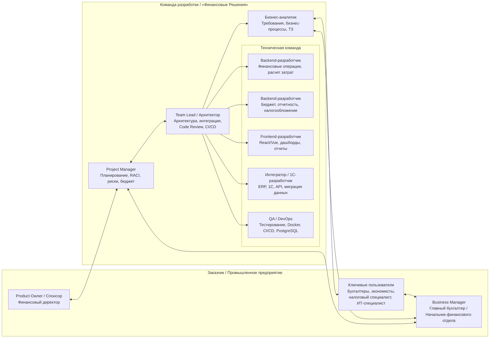
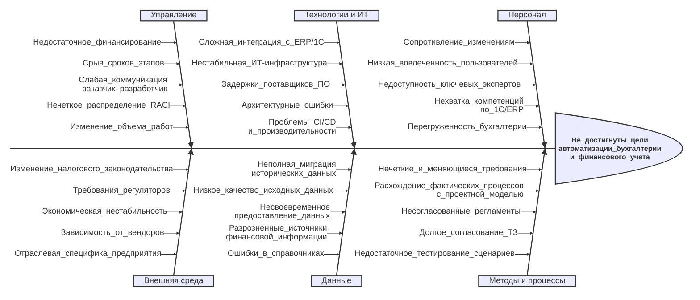
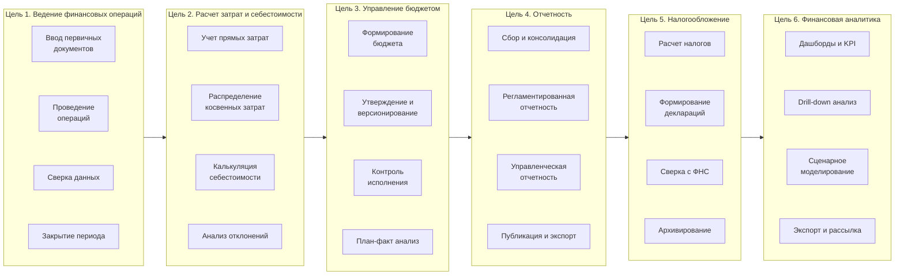
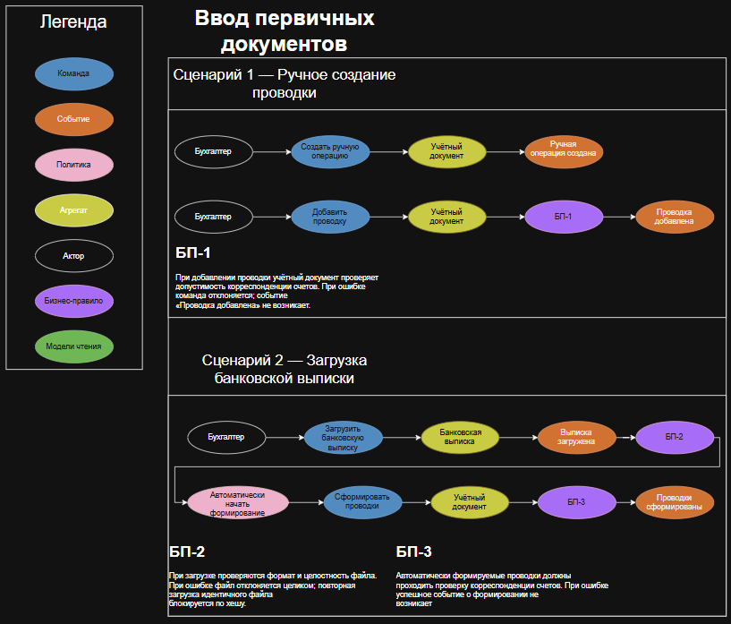

# Оглавление
- [Практика 1-4](#практика-1-4)
    - [Организационная диаграмма](#организационная-диаграмма)
    - [Анализ участников проекта](#анализ-участников-проекта)
    - [Три способа выявления проблем](#результаты-использования-трех-способов-выявления-проблем-с-выявленными-проблемами)
        - [1. Диаграмма Ишикавы](#1-диаграмма-ишикавы)
        - [2. SWOT-анализ](#2-swot-анализ)
        - [3. Анализ методом «5 Why»](#3-анализ-методом-5-why)
    - [Логико-структурная матрица проекта](#логико-структурная-матрица-проекта)
- [Практика 5-8](#практика-5-8)
    - [Цели и шаги](#цели-и-шаги-для-достижения-целей)
    - [User Story Map](#пользовательские-истории-и-mvp)
    - [Границы MVP](#границы-mvp)
    - [Инварианты](#известные-инварианты)
    - [Особенности разработки](#особенности-разработки-которые-должна-учесть-команда)
- [Практика 5-8 (Event Storming)](#практика-5-8_ES)
    - [Словарь проекта](#cловарь-проекта)
    - [Агрегаторы](#агрегаторы)
    - [Доменов на основе агрегатов](#доменов-на-основе-агрегатов)
    - [Базовое архитектурное решение](#базовое-архитектурное-решение)
    - [Диаграмма Event Storming](#диаграмма-event-storming)

---

Тема: "Создание интегрированной системы автоматизации бухгалтерии и финансового учета промышленного предприятия для компании «Финансовые Решения»"

**ЭФМО-01-25**
- Коляда Даниил
- Бакланова Екатерина
- Борисов Денис

# Практика 1-4

## Организационная диаграмма

## Анализ участников проекта

| Группа участников | Выгода / Интересы | Требования к участию | Механизм участия | Риски и допущения |
|-|-|-|-|-|
| **Спонсор / Заказчик** | **+** Получение точной и своевременной финансовой аналитики для стратегических решений. **+** Оптимизация бюджета и контроль затрат. **-** Риск превышения бюджета или сроков проекта. | Утверждение бюджета, стратегических целей и приемка ключевых вех. | Еженедельные статус-встречи с PM. Участие в стратегических сессиях. Утверждение отчетов. | **Риски:** Изменение приоритетов бизнеса, сокращение финансирования. **Допущения:** Заказчик участвует в процессах принятия решений и согласований, обеспечивает поддержку на уровне руководства. |
| **Главный бухгалтер / Начальник отдела бухгалетрии** | **+** Упрощение процесса закрытия периода и подготовки отчетности. **+** Снижение количества ошибок. **-** Необходимость адаптации к новым регламентам работы. | Согласование ТЗ, методологии учета и участие в приемочном тестировании. | Рабочие группы по сбору требований. Регулярные демо-презентации. Приемочные испытания. | **Риски:** Сопротивление изменениям, нечеткие требования с его стороны. **Допущения:** Выделяет ключевых экспертов для работы с бизнес-аналитиком и тестированием. |
| **Ключевые пользователи (бухгалтеры, экономисты, налоговые специалисты и т.д.)** | **+** Автоматизация рутины, удобный интерфейс, снижение нагрузки. **-** Страх сокращения штата или увеличения нагрузки в период внедрения. | Предоставление обратной связи по юзабилити, тестирование сценариев, участие в обучении. | Опросы, фокус-группы. Баг-репорты в системе трекинга. Обучение и интерактивные сессии. | **Риски:** Низкая вовлеченность, саботаж внедрения. **Допущения:** Пользователи мотивированы на улучшение условий труда и готовы учиться. |
| **IT команда заказчика** | **+** Современная, поддерживаемая ИТ-инфраструктура. **-** Дополнительная нагрузка по поддержке нового ПО и обеспечению безопасности. | Обеспечение интеграции с текущей инфраструктурой, соблюдение политик безопасности. | Технические совещания с командой разработки. Передача документации. Совместное развертывание. | **Риски:** Нехватка компетенций, конфликт с текущими ИТ-стандартами. **Допущения:** ИТ-служба готова выделить ресурсы для интеграции и тестирования. |
| **Команда разработки** | **+** Успешная реализация проекта, прибыль, укрепление репутации. **-** Переработки, риск выгорания из-за сжатых сроков. | Четкие и стабильные требования, доступ к экспертам заказчика, своевременное финансирование. | Agile-спринты (Scrum/Kanban), ежедневные статусы, ретроспективы. Демо для заказчика. | **Риски:** «Расползание» требований (scope creep), задержки со стороны заказчика. **Допущения:** Команда укомплектована необходимыми специалистами (1С, Backend, Frontend). |

## Результаты использования трех способов выявления проблем с выявленными проблемами

### 1. Диаграмма Ишикавы

---

### 2. SWOT-анализ

| **Сильные стороны** | **Слабые стороны** |
|-|-|
| 1. Автоматизация рутинных операций бухгалтерии и расчета затрат, что снижает трудозатраты. 2. Централизованное хранение данных и возможность получения финансовой аналитики в реальном времени. 3. Интеграция с существующими ERP/1С системами предприятия, что обеспечивает целостность данных. 4. Наличие специализированных модулей под нужды промышленного предприятия (бюджетирование, налогообложение). | 1. Высокая сложность интеграции с устаревшим или нестандартным ИТ-ландшафтом заказчика. 2. Значительные ресурсные и временные затраты на разработку, миграцию данных и поддержку. 3. Возможное сопротивление изменениям со стороны бухгалтеров и экономистов (привычка к старым методам). 4. Потребность в длительном обучении персонала работе с новыми модулями. 5. Жесткие требования к точности миграции и надежности хранения исторических данных. |
| **Возможности** | **Угрозы** |
| 1. Повышение качества управления финансами и скорости принятия управленческих решений. 2. Снижение операционных расходов за счет уменьшения бумажной работы и ошибок ручного ввода. 3. Масштабируемость решения — возможность предложить продукт другим промышленным предприятиям. 4. Соответствие современным тенденциям цифровизации промышленности. | 1. Изменения в законодательстве (налоги, бухучет), требующие срочной доработки системы. 2. Риск технических сбоев или потери данных в период внедрения, что может парализовать и/или повредить финансовую отчетность. 3. Необходимость гарантий ненарушения процессов аудита. 4. Срыв сроков поставщиками смежного ПО по интеграции. 5. Утечка конфиденциальных финансовых данных. |

---

### 3. Анализ методом «5 Why»

**Прогнозируемый риск:** Существует высокая вероятность того, что после внедрения системы бухгалтеры и экономисты вернутся к использованию старой системы (Excel) для нестандартных расчетов, что приведет к расхождениям данных и срыву сроков закрытия отчетного периода.

1. **Почему существует риск возврата к старому ПО?**
   *Потому что разрабатываемая система может не учитывать все ежедневные рабочие сценарии и нестандартные расчетные таблицы, которые рядовые специалисты используют сейчас.*
2. **Почему система может не учитывать эти сценарии?**
   *Потому что на этапе сбора требований основное внимание уделяется регламентированной отчетности для руководства, а не ежедневной рутине рядовых пользователей.*
3. **Почему на этапе сбора требований упускается рутина рядовых пользователей?**
   *Потому что в план проекта не заложены обязательные мероприятия по глубокому погружению в их работу (например, теневое наблюдение или детальные воркшопы).*
4. **Почему в план проекта не заложены такие мероприятия?**
   *Потому что команда проекта и руководство заказчика недооценивают сложность и вариативность реальных бизнес-процессов на промышленном предприятии (сложная калькуляция себестоимости).*
5. **Почему недооценивается сложность процессов?**
   *Потому что отсутствует предварительный детальный анализ бизнес-процессов (As-Is) на уровне каждого рабочего места с участием самих исполнителей.*

**Корневая причина (Root Cause):**
Отсутствие в методологии проекта обязательного этапа глубокого анализа пользовательских сценариев и вовлечения ключевых пользователей в процесс проектирования требований.

**План действий (для включения в WBS на этапе планирования):**
1. Включить в этап анализа работы по теневому наблюдению за бухгалтерами и экономистами для выявления нестандартных Excel-шаблонов.
2. Провести серию воркшопов с рядовыми пользователями для картирования их ежедневных сценариев.
3. Создать интерактивные прототипы интерфейсов для нестандартных расчетов и протестировать их на фокус-группе до начала разработки бэкенда.
4. Назначить нескольких опытных сотрудников для участия в приемке требований на этапе проектирования.

## Логико-структурная матрица проекта

| | **Описание** | **Показатели** | **Измерения** | **Допущения** |
|---|---|---|---|---|
| **Цель первого уровня** | Создать и внедрить интегрированную систему автоматизации бухгалтерии и финансового учета промышленного предприятия для компании «Финансовые Решения», обеспечивающую повышение точности учета, упрощение отчетности и надежную финансовую аналитику для управленческих решений. | 1. Сокращение времени закрытия отчетного периода не менее чем на 40%. 2. Снижение количества ошибок в финансовой отчетности на 90%. 3. Внедрение 100% заявленных модулей: финансовые операции, затраты, бюджет, отчетность, налогообложение. | 1. Срок проекта — 12 месяцев. 2. Утвержденный бюджет проекта. 3. Количество автоматизируемых модулей — 5. 4. Количество пользователей — не менее 50. 5. Точность финансовых данных — не ниже 99,5%. 6. Удовлетворенность пользователей — не ниже 85%. | **Риски:** сопротивление персонала изменениям; нечеткие требования заказчика; задержки интеграции с существующими ИТ-системами. **Допущения:** заказчик выделяет ключевых экспертов; финансирование поступает своевременно; доступны необходимые исторические данные. |
| **Цель второго уровня** | 1. Разработать модули учета финансовых операций и расчета затрат. 2. Разработать модуль управления бюджетом и финансового планирования. 3. Разработать модуль отчетности и налогообложения. 4. Обеспечить интеграцию системы с ИТ-ландшафтом и данными предприятия. 5. Внедрить систему, обучить пользователей и организовать поддержку. | 1. Выполнение плана разработки по 5 модулям на 100%. 2. Прохождение функционального тестирования не менее 95% сценариев. 3. Интеграция с бухгалтерскими/ERP-системами в 100% согласованных точек. 4. Обучение не менее 90% пользователей. | 1. Этапы и контрольные вехи проекта. 2. Функциональные модули системы. 3. Точки интеграции с внешними системами. 4. Роли пользователей и сценарии обучения. 5. Тестовые сценарии и приемочные испытания. | **Риски:** изменение требований в ходе проекта; нехватка данных для миграции; срыв сроков поставщиками ПО. **Допущения:** требования стабилизируются после этапа обследования; ИТ-инфраструктура заказчика стабильна; ключевые пользователи доступны для тестирования. |
| **Результаты** | 1.1. Спецификация и прототип модулей учета финансовых операций и расчета затрат утверждены. 1.2. Модули учета финансовых операций и расчета затрат разработаны и протестированы. 2.1. Модуль управления бюджетом разработан и настроен. 2.2. Подсистема бюджетного контроля и план-факт анализа внедрена. 3.1. Модуль отчетности и налогообложения разработан. 3.2. Регламентированная и управленческая отчетность автоматизирована. 4.1. Интеграционные интерфейсы с учетными системами реализованы. 4.2. Миграция исторических данных выполнена и проверена. 5.1. Система внедрена в опытную и промышленную эксплуатацию. 5.2. Пользователи обучены, регламенты поддержки переданы. | 1. Доля выполненных результатов — 100% (10/10). 2. Количество автоматизированных отчетных форм — не менее 30. 3. Доля автоматизированных операций — не менее 80%. 4. Успешное прохождение приемочных испытаний — не менее 95% сценариев. | 1. Утвержденные документы по результатам. 2. Количество модулей и отчетных форм. 3. Объем мигрированных данных. 4. Количество обученных пользователей. 5. Результаты приемочных испытаний. | **Риски:** неполная миграция данных; низкая вовлеченность пользователей; расхождение фактических процессов с проектной моделью. **Допущения:** данные предоставляются в согласованные сроки; пользователи участвуют в тестировании; регламенты согласуются с руководством. |
| **Действия** | 1.1.1. Провести обследование бизнес-процессов бухгалтерии и финансового учета. 1.2.1. Разработать техническое задание и архитектуру интегрированной системы. 2.1.1. Настроить и доработать модули учета финансовых операций, затрат и бюджета. 3.1.1. Реализовать модули отчетности и налогообложения. 4.1.1. Выполнить интеграцию с ERP/1С и миграцию данных. 5.1.1. Провести тестирование, опытную эксплуатацию и обучение пользователей. 5.2.1. Ввести систему в промышленную эксплуатацию и передать в поддержку. | 1. Утвержденное ТЗ — 1 документ. 2. Описанные бизнес-процессы — 100%. 3. Разработанные модули — 5. 4. Интеграционные сценарии — не менее 10. 5. Автоматизированные отчетные формы — не менее 30. 6. Мигрированные записи — 100% проверенных данных. 7. Обученные пользователи — не менее 90%. 8. Успешные приемочные тесты — не менее 95%. 9. Соблюдение сроков этапов — не менее 90% вех. 10. Критические дефекты после внедрения — не более 5. |  | **Риски:** изменение требований; нехватка данных для миграции; срыв сроков поставщиками. **Допущения:** доступность ключевых пользователей; своевременное финансирование; стабильная ИТ-инфраструктура. |

# Практика 5-8

## Цели и шаги для достижения целей

## Пользовательские истории и MVP

<table>

  <thead>
    <tr>
      <th>Шаг</th>
      <th>MVP</th>
      <th>Release 2</th>
      <th>Release 3</th>
    </tr>
  </thead>

  <tbody>
  
  <tr>
    <td rowspan="2">1.1 Ввод первичных документов</td>
    <td>Как бухгалтер, я хочу вручную создавать проводки с проверкой корреспонденции счетов, чтобы избежать ошибок</td>
    <td>Как бухгалтер, я хочу прикреплять сканы первичных документов к проводкам</td>
    <td></td>
  </tr>
  <tr>
    <td>Как бухгалтер, я хочу загружать банковские выписки (клиент-банк) и автоматически формировать проводки</td>
    <td>Как бухгалтер, я хочу использовать шаблоны типовых операций для массового ввода</td>
    <td></td>
  </tr>
  
  <tr>
    <td rowspan="3">1.2 Проведение операций</td>
    <td>Как бухгалтер, я хочу проводить документы с контролем двойной записи и периода</td>
    <td>Как бухгалтер, я хочу выполнять групповое проведение документов</td>
    <td></td>
  </tr>
  <tr>
    <td>Как главный бухгалтер, я хочу запрещать редактирование проведенных документов (только сторно)</td>
    <td></td>
    <td></td>
  </tr>
  <tr>
    <td>Как система, я должна автоматически пересчитывать остатки при проведении</td>
    <td></td>
    <td></td>
  </tr>
  
  <tr>
    <td rowspan="2">1.3 Сверка данных</td>
    <td>Как бухгалтер, я хочу формировать оборотно-сальдовую ведомость по счету/субконто</td>
    <td>Как бухгалтер, я хочу сверять данные с банком (акт сверки)</td>
    <td></td>
  </tr>
  <tr>
    <td></td>
    <td>Как бухгалтер, я хочу видеть расхождения по контрагентам</td>
    <td></td>
  </tr>
  
  <tr>
    <td rowspan="1">1.4 Закрытие периода</td>
    <td>Как главный бухгалтер, я хочу закрывать период с блокировкой операций задним числом</td>
    <td>Как главный бухгалтер, я хочу выполнять регламентные операции закрытия (амортизация, курсовые разницы)</td>
    <td>Как главный бухгалтер, я хочу получать чек-лист закрытия периода</td>
  </tr>
  
  <tr>
    <td rowspan="3">2.1 Учет прямых затрат</td>
    <td>Как экономист, я хочу относить прямые затраты на заказы/продукты/цеха</td>
    <td></td>
    <td></td>
  </tr>
  <tr>
    <td>Как экономист, я хочу учитывать материальные затраты по нормам</td>
    <td></td>
    <td></td>
  </tr>
  <tr>
    <td>Как экономист, я хочу видеть структуру затрат по элементам</td>
    <td></td>
    <td></td>
  </tr>
  
  <tr>
    <td rowspan="2">2.2 Распределение косвенных</td>
    <td>Как экономист, я хочу настраивать базы распределения косвенных затрат</td>
    <td>Как экономист, я хочу распределять общепроизводственные и общехозяйственные расходы</td>
    <td></td>
  </tr>
  <tr>
    <td></td>
    <td>Как экономист, я хочу пересчитывать распределение при изменении базы</td>
    <td></td>
  </tr>
  
  <tr>
    <td rowspan="2">2.3 Калькуляция себестоимости</td>
    <td>Как экономист, я хочу рассчитывать себестоимость по заказам (позаказный метод)</td>
    <td>Как экономист, я хочу рассчитывать себестоимость по переделам (попередельный метод)</td>
    <td></td>
  </tr>
  <tr>
    <td></td>
    <td>Как экономист, я хочу видеть калькуляционную карту изделия</td>
    <td></td>
  </tr>
  
  <tr>
    <td rowspan="2">2.4 Анализ отклонений</td>
    <td></td>
    <td>Как экономист, я хочу сравнивать план/факт по затратам</td>
    <td>Как руководитель, я хочу видеть топ-отклонения на дашборде</td>
  </tr>
  <tr>
    <td></td>
    <td>Как экономист, я хочу выявлять перерасход по статьям</td>
    <td></td>
  </tr>
  
  <tr>
    <td rowspan="2">3.1 Формирование бюджета</td>
    <td>Как финансовый менеджер, я хочу формировать бюджет доходов и расходов (БДР)</td>
    <td>Как финансовый менеджер, я хочу загружать бюджет из Excel</td>
    <td></td>
  </tr>
  <tr>
    <td>Как финансовый менеджер, я хочу формировать бюджет движения денежных средств (БДДС)</td>
    <td></td>
    <td></td>
  </tr>
  
  <tr>
    <td rowspan="2">3.2 Утверждение и версии</td>
    <td></td>
    <td>Как финансовый директор, я хочу утверждать бюджет с электронной подписью</td>
    <td>Как финансовый менеджер, я хочу сравнивать версии между собой</td>
  </tr>
  <tr>
    <td></td>
    <td>Как финансовый менеджер, я хочу вести версии бюджета</td>
    <td></td>
  </tr>
  
  <tr>
    <td rowspan="3">3.3 Контроль исполнения</td>
    <td></td>
    <td>Как финансовый менеджер, я хочу контролировать лимиты по заявкам на платеж</td>
    <td></td>
  </tr>
  <tr>
    <td></td>
    <td>Как финансовый менеджер, я хочу блокировать заявки сверх лимита</td>
    <td></td>
  </tr>
  <tr>
    <td></td>
    <td>Как система, я должна уведомлять о превышении лимитов</td>
    <td></td>
  </tr>
  
  <tr>
    <td rowspan="2">3.4 План-факт анализ</td>
    <td></td>
    <td>Как финансовый директор, я хочу видеть план-факт по бюджету в реальном времени</td>
    <td>Как финансовый директор, я хочу drill-down до первичного документа</td>
  </tr>
  <tr>
    <td></td>
    <td></td>
    <td>Как финансовый директор, я хочу скользящий прогноз</td>
  </tr>
  
  <tr>
    <td rowspan="1">4.1 Сбор и консолидация</td>
    <td>Как главный бухгалтер, я хочу автоматически собирать данные из модулей в отчетность</td>
    <td></td>
    <td>Как главный бухгалтер, я хочу консолидировать данные филиалов</td>
  </tr>
  
  <tr>
    <td rowspan="2">4.2 Регламентированная отчетность</td>
    <td>Как главный бухгалтер, я хочу формировать бухгалтерский баланс, ОФР, ОДДС</td>
    <td>Как главный бухгалтер, я хочу проверять контрольные соотношения ФНС</td>
    <td></td>
  </tr>
  <tr>
    <td>Как главный бухгалтер, я хочу формировать формы РСБУ в актуальных форматах</td>
    <td></td>
    <td></td>
  </tr>
  
  <tr>
    <td rowspan="2">4.3 Управленческая отчетность</td>
    <td></td>
    <td>Как финансовый директор, я хочу настраивать отчеты конструктором</td>
    <td>Как руководитель, я хочу дашборды с ключевыми KPI</td>
  </tr>
  <tr>
    <td></td>
    <td>Как финансовый директор, я хочу видеть отчетность по ЦФО</td>
    <td></td>
  </tr>
  
  <tr>
    <td rowspan="1">4.4 Публикация и экспорт</td>
    <td>Как пользователь, я хочу экспортировать отчеты в Excel/PDF</td>
    <td></td>
    <td>Как пользователь, я хочу подписываться на периодическую рассылку отчетов</td>
  </tr>
  
  <tr>
    <td rowspan="2">5.1 Расчет налогов</td>
    <td>Как налоговый специалист, я хочу рассчитывать НДС (исходящий/входящий)</td>
    <td>Как налоговый специалист, я хочу рассчитывать имущественные налоги</td>
    <td></td>
  </tr>
  <tr>
    <td>Как налоговый специалист, я хочу рассчитывать налог на прибыль</td>
    <td>Как налоговый специалист, я хочу вести раздельный учет НДС</td>
    <td></td>
  </tr>
  
  <tr>
    <td rowspan="2">5.2 Формирование деклараций</td>
    <td>Как налоговый специалист, я хочу формировать декларации по НДС, прибыли, имуществу</td>
    <td>Как налоговый специалист, я хочу проверять декларации перед отправкой</td>
    <td></td>
  </tr>
  <tr>
    <td>Как налоговый специалист, я хочу формировать книги покупок и продаж</td>
    <td></td>
    <td></td>
  </tr>
  
  <tr>
    <td rowspan="1">5.3 Сверка с ФНС</td>
    <td></td>
    <td>Как налоговый специалист, я хочу загружать требования и сверки от ФНС</td>
    <td>Как налоговый специалист, я хочу сверять данные с личным кабинетом ФНС</td>
  </tr>
  
  <tr>
    <td rowspan="1">5.4 Архивирование</td>
    <td>Как налоговый специалист, я хочу хранить декларации и подтверждения отправки</td>
    <td>Как система, я должна обеспечивать неизменяемый архив (WORM)</td>
    <td></td>
  </tr>
  
  <tr>
    <td rowspan="2">6.1 Дашборды и KPI</td>
    <td></td>
    <td></td>
    <td>Как финансовый директор, я хочу видеть дашборд с ключевыми метриками (EBITDA, cash flow, оборачиваемость)</td>
  </tr>
  <tr>
    <td></td>
    <td></td>
    <td>Как руководитель, я хочу получать уведомления об отклонениях KPI</td>
  </tr>
  
  <tr>
    <td rowspan="1">6.2 Drill-down анализ</td>
    <td></td>
    <td></td>
    <td>Как аналитик, я хочу проваливаться от показателя до проводки</td>
  </tr>
  
  <tr>
    <td rowspan="1">6.3 Сценарное моделирование</td>
    <td></td>
    <td></td>
    <td>Как финансовый директор, я хочу моделировать «что-если» сценарии по бюджету</td>
  </tr>
  
  <tr>
    <td rowspan="2">6.4 Экспорт и рассылка</td>
    <td></td>
    <td></td>
    <td>Как аналитик, я хочу выгружать данные в BI-систему (Power BI)</td>
  </tr>
  <tr>
    <td></td>
    <td></td>
    <td>Как руководитель, я хочу получать отчеты на email по расписанию</td>
  </tr>

  </tbody>
</table>

## Границы MVP

**В MVP входят:**
- Минимальный набор регламентированной отчетности (баланс, ОФР, ОДДС, декларации НДС и прибыли)
- Роли: бухгалтер, экономист, главный бухгалтер, финансовый менеджер, администратор
- Интеграция с 1С:Бухгалтерия и клиент-банком в одну сторону (импорт)

**Не входят в MVP (Release 2–3):**
- Управленческие дашборды и BI
- Сценарное моделирование
- Консолидация филиалов
- План-факт в реальном времени
- Электронная подпись и ЭДО с ФНС
- Мобильное приложение

## Известные инварианты

| № | Инвариант | Область |
|-|-|-|
| 1 | Дебет всегда равен кредиту в любой транзакции (двойная запись) | Учет |
| 2 | Проведенный документ неизменяем; исправления только через сторно | Учет |
| 3 | После закрытия периода операции задним числом запрещены | Учет |
| 4 | Все суммы хранятся в копейках (целочисленный тип); округление — по правилам РСБУ | Финансы |
| 5 | Базовая валюта — RUB; мультивалютность только для расчетов с курсовой разницей | Финансы |
| 6 | Один пользователь не может одновременно быть автором и утверждающим документа | Безопасность |
| 7 | Каждое действие пользователя фиксируется в неизменяемом аудит-логе | Безопасность |
| 8 | Все операции идемпотентны при интеграции (по внешнему id) | Интеграция |
| 9 | Любая финансовая операция выполняется в ACID-транзакции | Данные |
| 10 | Налоговый и бухгалтерский учет ведутся параллельно, но на одних первичных данных | Налоги |
| 11 | Все расчеты налогов соответствуют актуальной редакции НК РФ на дату расчета | Налоги |
| 12 | Разделение доступа по ролям (RBAC) и по подразделениям (row-level security) | Безопасность |

## Особенности разработки, которые должна учесть команда

**Архитектура и данные**
- Микросервисная архитектура с четким разделением: finance-service, cost-service, budget-service, reporting-service, tax-service, integration-service, auth-service
- Event sourcing для журнала проводок — возможность восстановить состояние на любую дату
- CQRS для тяжелых отчетов: отдельные read-модели, чтобы не блокировать запись
- PostgreSQL 17 с партиционированием таблиц проводок по периодам
- Очереди (RabbitMQ/Kafka) для асинхронных расчетов себестоимости и закрытия периода
- Идемпотентные API для интеграции с 1С и банком

**Безопасность и соответствие**
- RBAC + ABAC — роли + атрибуты
- Аудит-лог с записью в отдельное хранилище (нельзя удалить)
- Шифрование персональных данных и банковских реквизитов
- WORM-хранилище для налоговых деклараций и архива
- Резервное копирование с RPO ≤ 15 мин, RTO ≤ 1 час

**Разработка и качество**
- Тестирование: unit, integration, E2E, нагрузочное
- Обязательные тест-кейсы на: двойную запись, закрытие периода, расчет НДС, курсовые разницы
- CI/CD с обязательным code review и статическим анализом
- Feature flags для поэтапного включения модулей
- Миграции БД обязательны для каждого релиза

**Интеграция**
- Обмен с 1С через REST API + очереди; протокол — JSON, версионирование API
- ЭДО с ФНС — через оператора с электронной подписью
- Экспорт в Excel — через шаблоны OpenXML, а не «сырые» CSV

**Эксплуатация**
- Мониторинг: Prometheus + Grafana, алерты на ошибки проводок и задержки интеграции
- Логирование: структурированные логи (JSON), correlation_id сквозь все сервисы
- Документация: OpenAPI для всех API, ADR для архитектурных решений
- Обучение: видеоинструкции + интерактивные туры внутри системы

**Предметные особенности**
- Сложная калькуляция себестоимости на промышленном предприятии
- Раздельный учет НДС (экспорт, льготы, 5%-правило)
- Учет незавершенного производства (НЗП) на конец периода
- Курсовые разницы и переоценка валютных остатков ежемесячно
- Резервы (по сомнительным долгам, отпускам, гарантиям) — ежемесячный пересчет

# Практика 5-8 Event Storming

## Cловарь проекта

| Термин | Определение |
|---|---|
| Аутсорсинг | Передача выполнения определённых работ или функций внешнему исполнителю на основании договора. |
| База распределения | Показатель, используемый для пропорционального распределения косвенных затрат между объектами учёта. |
| Банковская выписка | Документ, содержащий сведения о движении денежных средств по банковскому счёту за определённый период. |
| БД | База данных — организованное хранилище структурированной информации. |
| БДДС | Бюджет движения денежных средств — финансовый план поступлений и выплат денежных средств. |
| БДР | Бюджет доходов и расходов — финансовый план доходов, расходов и ожидаемого финансового результата. |
| Бюджет | Финансовый план доходов, расходов или денежных потоков организации за определённый период. |
| Двойная запись | Принцип бухгалтерского учёта, при котором хозяйственная операция отражается в равной сумме по дебету одного и кредиту другого счёта. |
| Дебет | Левая сторона бухгалтерского счёта, используемая для отражения хозяйственных операций. |
| Запись затрат | Учётная запись, фиксирующая сумму затрат и объект, на который они отнесены. |
| ИСА | Интегрированной Системы Автоматизации — взаимосвязанная совокупность автоматизированных подсистем, которые функционируют в едином информационном пространстве.|
| Калькуляция заказа | Расчёт себестоимости выполнения конкретного заказа на основе относящихся к нему затрат. |
| Книги покупок и продаж | Налоговые регистры, применяемые для учёта операций, связанных с исчислением НДС. |
| Корреспонденция счетов | Связь между дебетуемым и кредитуемым бухгалтерскими счетами при отражении хозяйственной операции. |
| Косвенные затраты | Расходы, которые нельзя непосредственно отнести к конкретному объекту калькуляции без применения способа распределения. |
| Кредит | Правая сторона бухгалтерского счёта, используемая для отражения хозяйственных операций. |
| Модульный монолит | Архитектура программной системы, в которой функциональные модули логически разделены, но развёртываются как единое приложение. |
| Налоговая декларация | Документ установленной формы, содержащий сведения, необходимые для исчисления и декларирования налога. |
| Налоговый архив | Совокупность хранимых налоговых документов, деклараций и связанных с ними подтверждений. |
| Налоговый расчёт | Определение суммы налогового обязательства на основании налоговой базы, ставок и применимых правил. |
| НДС | Налог на добавленную стоимость — косвенный налог, связанный с реализацией товаров, работ и услуг. |
| Норма расхода | Установленное количество материального ресурса, необходимое для выпуска единицы продукции или выполнения работы. |
| Оборотно-сальдовая ведомость | Бухгалтерский отчёт, отражающий начальные и конечные остатки, а также обороты по счетам за период. |
| ОДДС | Отчёт о движении денежных средств — форма отчётности, раскрывающая поступления и выбытия денежных средств. |
| ОСВ | Оборотно-сальдовая ведомость — отчёт об остатках и оборотах по счетам бухгалтерского учёта. |
| Отчётный комплект | Совокупность взаимосвязанных форм финансовой отчётности, подготовленных за один отчётный период. |
| ОФР | Отчёт о финансовых результатах — форма бухгалтерской отчётности о доходах, расходах и финансовом результате организации. |
| План-факт анализ | Сопоставление плановых показателей с фактическими для выявления и оценки отклонений. |
| Подтверждение отправки | Документ или электронное сообщение, удостоверяющее факт передачи отчётности получателю. |
| Проведение | Операция учёта, после которой содержащиеся в документе записи учитываются в бухгалтерских регистрах. |
| Проводка | Бухгалтерская запись, отражающая сумму хозяйственной операции по дебету одного и кредиту другого счёта. |
| Прямые затраты | Расходы, непосредственно связанные с конкретным заказом, изделием, видом продукции или другим объектом учёта. |
| РСБУ | Российские стандарты бухгалтерского учёта — совокупность правил ведения бухгалтерского учёта и составления отчётности в России. |
| Ручная операция | Учётная операция, проводки по которой вводятся бухгалтером вручную. |
| Себестоимость | Денежная оценка затрат на производство продукции, выполнение работы или оказание услуги. |
| Сторно | Способ исправления бухгалтерских записей путём аннулирования или обратного отражения ранее учтённых сумм. |
| Субконто | Аналитический признак, позволяющий детализировать учёт по бухгалтерскому счёту. |
| ТУКРПО | Название разрабатываемой информационной системы для ведения учёта, планирования, расчётов и подготовки отчётности. |
| Учётный документ | Документ, на основании которого регистрируются и отражаются хозяйственные операции в системе учёта. |
| Учётный период | Промежуток времени, за который учитываются хозяйственные операции и формируются учётные данные. |
| ФНС | Федеральная налоговая служба — федеральный орган исполнительной власти России, осуществляющий контроль и надзор в сфере налогов и сборов. |
| Экспорт отчётности | Сохранение или передача отчётных данных во внешнем файловом формате. |
| API | Application Programming Interface — программный интерфейс для взаимодействия компонентов или систем. |
| CI/CD | Continuous Integration / Continuous Delivery — практики автоматизации интеграции, проверки и доставки изменений программного обеспечения. |
| KPI | Key Performance Indicator — ключевой показатель эффективности, используемый для оценки достижения установленных целей. |
| MVP | Minimum Viable Product — минимальная жизнеспособная версия продукта, содержащая основные функции для проверки его практической ценности. |
| PDF | Portable Document Format — формат электронных документов, предназначенный для сохранения внешнего вида при просмотре и печати. |
| WORM | Write Once, Read Many — принцип хранения данных, при котором записанная информация доступна для многократного чтения без изменения. |

## Агрегаторы

Агрегат — граница изменения и согласованности данных внутри предметной области. Он принимает команды и обеспечивает инварианты. В данном документе описываются Агрегаторы, которые требуется для последующего проектирование ИСА для автоматизации бухгалтерии и финансового учета промышленного предприятия в рамках MVP.

| Предметная область | Агрегат-кандидат | Ответственность и ограничения |
|---|---|---|
| Бухгалтерский учёт | Учётный документ | Содержит проводки и статус документа; проверяет корреспонденцию счетов и равенство дебета и кредита. Проведение разрешено только в открытом учётном периоде. |
| Бухгалтерский учёт | Банковская выписка | Хранит сведения об импорте выписки; проверяет корректность данных. Система предотвращает повторную загрузку идентичного файла. |
| Бухгалтерский учёт | Учётный период | Хранит состояние периода; после закрытия запрещает повторное открытие. |
| Затраты и себестоимость | Запись затрат | Фиксирует сумму и объект отнесения прямой затраты; исключает повторный учёт одной исходной операции. |
| Затраты и себестоимость | Норма расхода | Хранит действующую норму расхода материала для продукта; обеспечивает корректность и положительное значение нормы. |
| Затраты и себестоимость | Правило распределения | Хранит базу и параметры распределения косвенных затрат. |
| Затраты и себестоимость | Калькуляция заказа | Фиксирует результат расчёта себестоимости заказа; повторный расчёт обновляет результат. |
| Бюджетирование | Бюджет | Содержит плановые показатели БДР либо БДДС за период, рассчитывает итоги и контролирует актуальность бюджета. |
| Отчётность | Отчётный комплект | Хранит согласованный набор сформированных форм: баланс, ОФР и ОДДС за один отчётный период. |
| Налоговый учёт | Налоговый расчёт | Хранит рассчитанную сумму налога, вид налога, период и данные, использованные для расчёта. |
| Налоговый учёт | Налоговая декларация | Хранит сформированную декларацию, её вид, период и статус подготовки. |
| Налоговый учёт | Налоговый архив | Учитывает сохранённые декларации, реквизиты архивных записей и связанные подтверждения отправки. |

## Доменов на основе агрегатов

В данном документе выделяются пять предметных подобластей, объединяющих связанные агрегаты и бизнес-правила. Для практической реализации каждой подобласти соответствует отдельный модуль с определёнными интерфейсами.

| **Домен / модуль**                  | **Включённые агрегаты**                                                  | **Назначение и взаимодействие**                                                                                        |
|-------------------------------------|--------------------------------------------------------------------------|------------------------------------------------------------------------------------------------------------------------|
| **D1. Бухгалтерский учёт**          | Учётный документ; Банковская выписка; Учётный период.                    | Ввод, проведение и сторно, контроль периода, проводки и остатки. Источник проведённых данных для отчётности и налогов. |
| **D2. Учёт затрат и себестоимости** | Запись затрат; Норма расхода; Правило распределения; Калькуляция заказа. | Отнесение прямых затрат, ведение норм расхода, настройка базы распределения и позаказная калькуляция.                     |
| **D3. Бюджетирование**              | Бюджет.                                                                  | Формирование и хранение месячных БДР и БДДС; не создаёт бухгалтерские проводки.                                        |
| **D4. Отчётность**                  | Отчётный комплект.                                                       | Получение учётных данных, формирование и сохранение форм РСБУ, просмотр и экспорт результатов.                         |
| **D5. Налоговый учёт**              | Налоговый расчёт; Налоговая декларация; Налоговый архив.                 | Расчёт НДС и прибыли, создание деклараций, книги покупок/продаж и архивирование файлов.                                |

Границы взаимодействия: 
D4 и D5 получают только необходимые данные из D1 по внутренним интерфейсам; 
D2 и D3 ведут собственные расчёты и не изменяют бухгалтерские остатки. 
Прямая запись в таблицы чужого модуля запрещается.

## Распределение доменов по командам разработки

Для разработки ИСА принимается модель двух внутренних команд и одного внешнего подрядчика.

| **Исполнитель**                                  | **Закреплённые домены**                             | **Зона ответственности**                                                                                                                                          |
|--------------------------------------------------|-----------------------------------------------------|-------------------------------------------------------------------------------------------------------------------------------------------------------------------|
| **Внутренняя команда A — учётное ядро**          | D1 «Бухгалтерский учёт» и D5 «Налоговый учёт».      | Бухгалтерские правила, целостность учёта, налоговые расчёты, доступ к данным, внутренние API; окончательная проверка регламентированных форм.                     |
| **Внутренняя команда B — экономика**             | D2 «Затраты и себестоимость» и D3 «Бюджетирование». | Затраты, нормативы, калькуляции, БДР/БДДС, тестирование расчётных алгоритмов и интеграционные контракты с учётным ядром.                                          |
| **Аутсорс-команда — отчётность и представление** | D4 «Отчётность» (контролируемый объём работ).       | Реализация представления отчётного комплекта, шаблонов форм и экспорта Excel/PDF по согласованным спецификациям; без права изменять проводки и налоговые расчёты. |

Ответственным за приёмку домена D4 назначается внутренняя команда A. Она утверждает формулы и структуру регламентированных форм, проверяет контрольные наборы данных и принимает результаты подрядчика. Общие правила доступа, CI/CD, сопровождение базы данных и релизы остаются у внутренней стороны. Подрядчику выдаются обезличенные тестовые данные и доступ только к согласованным интерфейсам.

Подрядчику передаются только изолированные задачи представления и экспорта. Договор должен фиксировать входные структуры, тестовые примеры, критерии приёмки и требования к лицензиям.

## Базовое архитектурное решение

**Выбранная архитектура: модульный монолит с единым серверным приложением и логически изолированными доменными модулями.**

Клиентская часть отвечает за ввод и просмотр данных; бизнес-правила, вычисления и контроль доступа исполняются на сервере. Сервер содержит модули D1–D5 с отдельными прикладными интерфейсами. Основные структурированные данные хранятся в реляционной базе данных; файлы выписок, деклараций и подтверждений будут хранится в объектно-реляционная система управления базами, для обеспечение безопасного хранения финансово значимых данных.

**Аргументация выбранных архитектурных решений**

Так как MVP и последующие версии остаются в небольших и контроллируемых рамках, то разработка в рамках Микросервисной архитектуры экономически и экспуатационно излишне. Микросервисная архитектура приведет к увеличение как времени разработки и ее сложности, так и затрат на отдельное развертывание сервисов на оборудовании заказщика, распределение транзакций и создание механизма согласовании, для обеспечение когерентности данных.
Предложенная модульная система в рамках монолитной архитектуры способна оптимизировать работу приложение в уменьшении количесвто запросов на просмотр сохраненных или загружаемых документов и отчётов. А при работы с данные, они обновляются сихронно и не требуют дополнительной переадресации. 
При необходимости ИСА может быть расширенно требуемыми модулями, однако ядро системы должно оставаться монолитным.

## Диаграмма Event Storming

В качестве демонстрации построенной диаграммы Event Storming, предложен сценарицй **Ввод первичных документов**, описание других сценариев продемонстрированы в Приложение текущего Проектного документа для разработки ИСА бухгалтерии и финансового учета промышленного предприятия.

# Практика 5-8: Матрица WBS

## Цель работы

Разработать иерархическую структуру работ (WBS, Work Breakdown Structure) для проекта создания интегрированной системы автоматизации бухгалтерии и финансового учета промышленного предприятия для компании «Финансовые Решения» и перенести ее в [ClickUp](https://app.clickup.com/).

ГОТОВАЯ матрица доступна по ссылке - https://app.clickup.com/1500500000000364/v/li/1500500000001927

## Принципы декомпозиции

- Уровень 0 - проект целиком.
- Уровень 1 - крупные блоки работ, которые представлены родительскими задачами в ClickUp.
- Уровень 2 - пакеты работ/подзадачи, соответствующие кодам WBS.
- Каждая задача описывает результат, который можно проверить.
- Используется ранее выбранная архитектура **модульного монолита с логически изолированными доменными модулями**.

## Матрица WBS

В таблице приведены код элемента, название пакета работ, краткое описание ожидаемого результата и предполагаемый этап реализации. Коды обеспечивают однозначную связь между таблицей и иерархией задач в ClickUp. Столбец "Этап" помогает отличать минимально необходимую функциональность MVP от возможностей, которые планируется реализовать в следующих релизах. Е

| Код WBS | Элемент WBS / пакет работ | Содержание работ и ожидаемый результат | Этап |
|---|---|---|---|
| **0.0** | **Создание интегрированной системы автоматизации бухгалтерии и финансового учета** | Система реализована, протестирована, принята заказчиком и подготовлена к эксплуатации | Весь проект |
| **1.0** | **Управление проектом** | Организованы планирование, координация команды, контроль объема, сроков, рисков и изменений | Все этапы |
| 1.1 | Определение целей и границ проекта | Согласованы цели, ограничения, заинтересованные стороны и критерии успеха | Подготовка |
| 1.2 | Планирование этапов и сроков | Определены этапы, контрольные точки и последовательность работ | Подготовка / весь проект |
| 1.3 | Распределение ответственности | Определены роли участников и зоны ответственности | Подготовка |
| 1.4 | Управление рисками | Составлен и обновляется реестр рисков и мер реагирования | Весь проект |
| 1.5 | Контроль выполнения работ | Отслеживаются статусы, отклонения, изменения и результаты этапов | Весь проект |
| **2.0** | **Анализ и проектирование** | Согласованы требования, бизнес-процессы, модель предметной области и архитектура | До разработки MVP |
| 2.1 | Сбор и анализ требований | Согласованы функциональные и нефункциональные требования с участием ключевых пользователей | До разработки MVP |
| 2.2 | Анализ бизнес-процессов бухгалтерии | Описаны процессы финансовых операций, затрат, бюджетирования, отчетности и налогового учета | До разработки MVP |
| 2.3 | Моделирование предметной области | Уточнены единый язык, домены, агрегаты и границы модулей | До разработки MVP |
| 2.4 | Проектирование архитектуры системы | Зафиксировано решение о модульном монолите и взаимодействии доменных модулей | До разработки MVP |
| 2.5 | Проектирование структуры базы данных | Подготовлена схема данных, ограничения целостности и план миграций | До разработки MVP |
| **3.0** | **Разработка платформы и инфраструктуры** | Подготовлен технический каркас системы и среда разработки | MVP |
| 3.1 | Подготовка среды разработки | Настроены репозиторий, окружения и правила командной разработки | MVP |
| 3.2 | Настройка базы данных | Созданы схема базы данных, миграции и ограничения целостности | MVP |
| 3.3 | Реализация серверной части | Создано серверное приложение с логически изолированными модулями | MVP |
| 3.4 | Реализация пользовательского интерфейса | Созданы основные экраны и навигация для функций MVP | MVP |
| 3.5 | Настройка журналирования и мониторинга | Реализовано журналирование и базовый контроль состояния приложения | MVP |
| **4.0** | **Разработка модуля бухгалтерского учета** | Реализованы базовые операции бухгалтерского учета с проверкой корректности | MVP |
| 4.1 | Реализация справочников | Созданы справочники счетов, контрагентов и необходимых учетных объектов | MVP |
| 4.2 | Реализация учета хозяйственных операций | Реализовано создание и хранение учетных документов | MVP |
| 4.3 | Реализация учета счетов и проводок | Реализованы проводки и контроль принципа двойной записи | MVP |
| 4.4 | Реализация проверки корректности операций | Реализованы проверки, блокировка недопустимых действий и сообщения об ошибках | MVP |
| **5.0** | **Разработка модуля учета затрат и себестоимости** | Реализованы согласованные функции учета затрат промышленного предприятия | MVP / Release 2 |
| 5.1 | Определение статей затрат | Согласована классификация статей затрат | MVP |
| 5.2 | Реализация учета прямых затрат | Реализован учет прямых затрат по согласованным объектам калькуляции | MVP |
| 5.3 | Расширенное распределение косвенных затрат | Реализованы дополнительные правила и пересчет распределения косвенных затрат | Release 2 |
| 5.4 | Реализация расчета себестоимости | Реализован согласованный метод расчета себестоимости; дополнительные методы добавляются по User Story Map | MVP / Release 2 |
| **6.0** | **Разработка модуля бюджетирования** | Реализованы базовое формирование бюджета и последующие функции контроля исполнения | MVP / Release 2–3 |
| 6.1 | Формирование бюджета доходов и расходов (БДР) | Пользователь может формировать бюджет доходов и расходов | MVP |
| 6.2 | Формирование бюджета движения денежных средств (БДДС) | Пользователь может формировать бюджет движения денежных средств | MVP |
| 6.3 | Загрузка бюджета из Excel и ведение версий | Реализованы импорт бюджета и хранение его версий | Release 2 |
| 6.4 | Утверждение бюджета и контроль лимитов | Реализованы утверждение бюджета и контроль лимитов по согласованным заявкам | Release 2 |
| 6.5 | План-факт анализ и прогнозирование | Реализованы расширенный план-факт анализ, детализация и скользящий прогноз | Release 2–3 |
| **7.0** | **Разработка отчетности и финансовой аналитики** | Реализованы базовая регламентированная отчетность и последующие функции управленческой аналитики | MVP / Release 2–3 |
| 7.1 | Определение состава отчетов | Согласованы перечень отчетов, показатели и источники данных | До реализации отчетов |
| 7.2 | Реализация регламентированной финансовой отчетности | Реализованы согласованные формы: баланс, ОФР и ОДДС | MVP |
| 7.3 | Реализация управленческих отчетов | Реализованы дополнительные отчеты для анализа финансовых показателей | Release 2 |
| 7.4 | Реализация фильтрации и экспорта | Реализован экспорт отчетов в Excel/PDF в пределах согласованного объема | MVP / Release 3 для расширенных сценариев |
| 7.5 | Финансовая аналитика, дашборды и KPI | Реализованы дашборды, ключевые показатели и уведомления об отклонениях | Release 3 |
| 7.6 | Детализация показателей и сценарное моделирование | Реализован переход от показателя к проводке и моделирование сценариев «что-если» | Release 3 |
| **8.0** | **Реализация налогового учета** | Реализованы базовые согласованные налоговые расчеты и подготовка отчетных форм | MVP / Release 2–3 |
| 8.1 | Определение требований к налоговому учету | Согласованы применимые налоговые правила и состав данных | До реализации |
| 8.2 | Реализация основных налоговых расчетов | Реализованы расчеты НДС и налога на прибыль в согласованном объеме | MVP |
| 8.3 | Формирование налоговых отчетов | Реализованы декларации и книги покупок/продаж в пределах границ MVP | MVP |
| 8.4 | Расширенная сверка с ФНС | Реализована загрузка требований и расширенная сверка с данными ФНС | Release 2–3 |
| 8.5 | Хранение налоговых документов | Реализовано хранение деклараций и подтверждений отправки; расширенный неизменяемый архив — при согласовании | MVP / Release 2 |
| **9.0** | **Интеграции и миграция данных** | Настроен согласованный обмен данными и проверен перенос исходных данных | MVP / по согласованному объему |
| 9.1 | Анализ источников данных | Определены источники, форматы, правила загрузки и контрольные показатели | До миграции |
| 9.2 | Импорт из 1С:Бухгалтерии | Реализован односторонний импорт данных из 1С в систему | MVP |
| 9.3 | Импорт данных клиент-банка | Реализована односторонняя загрузка банковских выписок и обработка ошибок | MVP |
| 9.4 | Перенос и сверка исходных данных | Данные загружены и сверены по согласованным контрольным показателям | По согласованному объему |
| 9.5 | Дополнительные внешние интеграции | Реализованы дополнительные интеграции, если они отдельно согласованы | Release 2–3 / по согласованию |
| **10.0** | **Безопасность и надежность** | Настроены доступ, аудит действий и защита данных | MVP |
| 10.1 | Реализация аутентификации | Реализован безопасный вход пользователей | MVP |
| 10.2 | Настройка ролевой модели доступа | Доступ к функциям определяется назначенными ролями | MVP |
| 10.3 | Реализация аудита действий | Действия пользователей фиксируются в журнале аудита | MVP |
| 10.4 | Реализация резервного копирования | Настроено резервное копирование данных | MVP |
| 10.5 | Проверка восстановления данных | Проверено восстановление данных из резервной копии | MVP |
| **11.0** | **Тестирование и приемка** | Подтверждено соответствие реализованной системы требованиям | Каждый релиз |
| 11.1 | Разработка тестовых сценариев | Подготовлены сценарии на основе требований, инвариантов и пользовательских историй | MVP и последующие релизы |
| 11.2 | Модульное тестирование | Проверена корректность отдельных компонентов | Каждый релиз |
| 11.3 | Интеграционное тестирование | Проверено взаимодействие модулей и интеграций | Каждый релиз |
| 11.4 | Нагрузочное тестирование | Проверена работа системы при согласованной нагрузке | Перед приемкой релиза |
| 11.5 | Приемочное тестирование | Заказчик проверил критерии приемки и подтвердил готовность результата | Каждый релиз |
| **12.0** | **Развертывание и передача в эксплуатацию** | Система развернута, документация передана, пользователи подготовлены | Каждый релиз |
| 12.1 | Подготовка среды эксплуатации | Подготовлена среда и настроены необходимые доступы | MVP |
| 12.2 | Развертывание системы | Система развернута и проверена в целевой среде | Каждый релиз |
| 12.3 | Подготовка пользовательской документации | Подготовлены инструкции по реализованным пользовательским сценариям | Каждый релиз |
| 12.4 | Обучение пользователей | Ключевые пользователи ознакомлены с работой системы | MVP и при крупных обновлениях |
| 12.5 | Передача системы в эксплуатацию | Согласованы порядок поддержки, ответственные и обработка инцидентов | MVP |